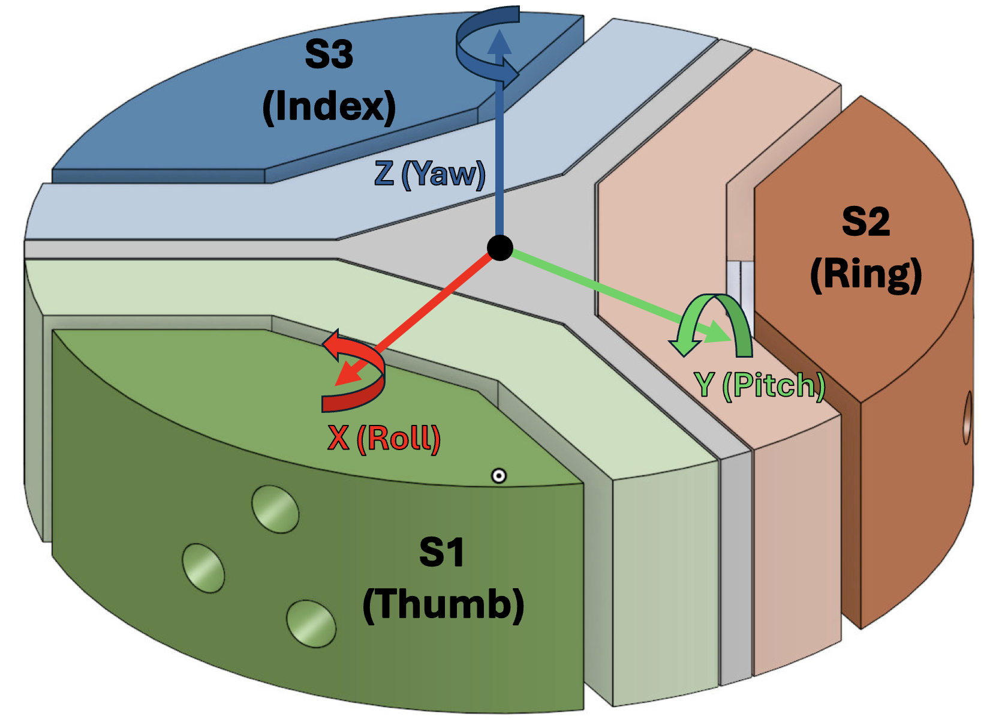

# Finger Manipulation Experiment Protocol

## Repository Layout

All acquisition and experiment functionality lives in `utils/`, grouped by purpose. Recorded and generated data lives in `data/`; analysis notebooks live in `data_process/`.

```text
utils/
├── acquisition/              # NI-DAQ and LabJack device readers
├── publishers/               # ROS 2 force publishing and frame transformations
├── recording/                # CSV recorders
├── calibration/              # Position sensor rotational error nodes
├── visualization/            # RViz object-axis visualization
├── gui/                      # Researcher and participant interface
├── launch/                   # Multi-recorder launcher
├── config/calibration_files/ # ATI .cal files
└── paths.py                  # Shared repository, data, and calibration paths
data/
├── user_*/                   # Participant recordings
├── sensor_bias/              # Sensor bias CSV and JSON files
├── synced_data/              # Synchronized analysis data
├── segmented_data/           # Segmented analysis data
└── analysis_results/         # PCA figures and other analysis outputs
data_process/                # Single-trial and multi-trial analysis notebooks
docs/images/                 # Protocol reference images
```

Existing experiment folders under `data/` retain their layout.

## Running the Experiment

Run the following commands from the repository root using the existing Python environment with ROS 2, the Polhemus workspace, and the NI-DAQ/LabJack drivers configured. The publishers require the corresponding hardware; finger-frame transformations also require the Polhemus TF stream. Source the ROS/workspace setup scripts as usual before starting nodes.

Start each publisher in its own terminal:

```bash
python -m utils.publishers.NIDAQ_ATI_publisher
python -m utils.publishers.Labjack_ATI_publisher
python -m utils.publishers.Object_Origin_ATI_publisher --ros-args -p diameter_mm:=50
```

Set `diameter_mm` to the object being used (`50` or `80`). The object-origin publisher subscribes to the raw force topics from the two hardware publishers.

Record a trial with one of the following commands, or use the launcher below to start all three recorders:

```bash
python -m utils.recording.force_trial_csv_recorder -u 1 -s 50 -t roll -tn 1
python -m utils.recording.force_raw_csv_recorder -u 1 -s 50 -t roll -tn 1
python -m utils.recording.object_origin_csv_recorder -u 1 -s 50 -t roll -tn 1

python -m utils.launch.recoder_launch -u 1 -s 50 -t roll -tn 1
```

The launcher opens three GNOME Terminal windows and requires `gnome-terminal`. The existing `recoder_launch` spelling is retained.

| Argument | Meaning |
| --- | --- |
| `-u`, `--user-number` | Participant number |
| `-s`, `--diameter-mm` | Object diameter: `50` or `80` |
| `-t`, `--task-performed` | `roll`, `pitch`, `yaw`, `finger_gating`, or `single_fg` |
| `-tn`, `--trial-number` | Trial number |
| `--duration-sec` | Recording duration; default `30`, or `0` until Ctrl+C |
| `--data-root` | Override the default repository `data/` directory |
| `--flush-every` | Flush CSV files after this many samples; default `25` |
| `--sensor-subfolders` | Put each finger's CSV in a separate sensor folder |
| `--overwrite` | Delete the existing trial folder before recording; otherwise append |

Default data and calibration paths are resolved from the repository location, independent of the working directory. The module commands above still require the repository root on Python's module search path. An explicitly supplied relative `--data-root` is relative to the working directory.

To use the researcher/participant GUI:

```bash
python -m utils.gui.study_gui --demo
python -m utils.gui.study_gui
```

The demo runs without ROS or sensors and requires a graphical desktop with Tkinter. The normal GUI uses the running publishers and records its selected topic set itself; do not run the standalone recorders into the same trial folder at the same time.

Calibration and visualization nodes are available as modules:

```bash
python -m utils.calibration.rotational_error_node
python -m utils.calibration.relative_rotational_error_node
python -m utils.visualization.object_axis_rviz_visualizer
```

## Sensors and Data

| Sensor | Interface | ATI calibration | Finger |
| --- | --- | --- | --- |
| 1 | NI-DAQ | FT44298 | Thumb |
| 2 | NI-DAQ | FT45281 | Middle |
| 3 | LabJack | FT44297 | Index |

Use the same finger-to-sensor mapping for position sensor calibration.

Current trial recordings are stored in:

```text
data/user_{number}/{diameter}mm/{task}/trial_{number}/
```

| Recorder | CSV filenames | CSV columns |
| --- | --- | --- |
| [Finger-frame force](utils/recording/force_trial_csv_recorder.py) | `thumb.csv`, `middle.csv`, `index.csv` | `source_timestamp_sec, Fx, Fy, Fz` |
| [Raw sensor force/torque](utils/recording/force_raw_csv_recorder.py) | `thumb_raw_force.csv`, `middle_raw_force.csv`, `index_raw_force.csv` | `source_timestamp_sec, Fx, Fy, Fz, Tx, Ty, Tz` |
| [Object-origin pipeline](utils/recording/object_origin_csv_recorder.py) | `object_origin_thumb_force.csv`, `object_origin_middle_force.csv`, `object_origin_index_force.csv` | `source_timestamp_sec, Fx, Fy, Fz` |

Here, raw sensor values have already been calibrated and bias-corrected. The object-origin pipeline currently publishes contact-frame force after the object-origin rotation and contact-position calculation; its existing topic and file names are preserved. The GUI writes the selected stream's three force components to `thumb.csv`, `middle.csv`, and `index.csv`, with trial metadata alongside them.

Legacy datasets may use `data/{rotation axis}/test_{number}/` with `raw_data.csv` and `transformed_data.csv`. Those older combined files contain three consecutive sensor blocks `[Fx, Fy, Fz, Tx, Ty, Tz]`; the transformed torque columns are zero placeholders. The current recorders use the per-finger formats shown above.

## Data Analysis

Start Jupyter from the repository root or `data_process/`, and open the appropriate notebook:

- [Single-trial Polhemus force analysis](data_process/single_case_polhemus_force_data_analysis.ipynb)
- [Multi-trial Polhemus force analysis](data_process/serial_polhemus_force_data_analysis.ipynb)
- [Single-trial object-origin pipeline analysis](data_process/single_case_object_origin_force_data_analysis.ipynb)
- [Multi-trial object-origin pipeline analysis](data_process/serial_object_origin_force_data_analysis.ipynb)
- [Exploratory notebook](data_process/test.ipynb)

Run the path setup cell first, then set the participant, diameter, task, and trial variables in the notebook. Paths resolve to the repository's `data/` directory. Synchronized and segmented files remain under `data/`, and exported PCA figures are saved to `data/analysis_results/`.

In the single-trial PCA routines, combined force and torque data is normalized with `StandardScaler` before PCA. Force-only analysis leaves scaling disabled to preserve the physical magnitude relationships.

## Finger Force to Finger Position Frame Calculations
Fingers 1 & 2 refer to [NIDAQ_ATI_publisher.py](utils/publishers/NIDAQ_ATI_publisher.py). </br>
Finger 3 refers to [Labjack_ATI_publisher.py](utils/publishers/Labjack_ATI_publisher.py).
<b><i><p style= "font-size: 16px;" > Finger Force 1 to Finger  Postion 1 Rotations: </b> </br>
</i> <p style= "font-size: 13px;" > 
<b>F<sub>finger<sub>1</sub></sub></b>
=(
R<sup>T</sup><sub>base←finger<sub>1</sub></sub>
R<sub>base←obj</sub>
R<sub>force<sub>2</sub>'←force<sub>1</sub>'</sub>(120°)
R<sub>object←force<sub>1</sub>'</sub>
R<sub>force<sub>1</sub>'←force<sub>1</sub></sub>(48°)
)
F<sub>force<sub>1</sub></sub>
<b><i><p style= "font-size: 16px;" > Finger Force 2 to Finger Position 2 Rotations:</b> </br>
</i><p style= "font-size: 13px;" > 
<i><b>F<sub>finger<sub>2</sub></sub></b>
=(
R<sup>T</sup><sub>base←finger<sub>2</sub></sub>
R<sub>base←obj</sub>
R<sub>force<sub>2</sub>'←force<sub>2</sub>'</sub>(0°)
R<sub>object←force<sub>2</sub>'</sub>
R<sub>force<sub>2</sub>'←force<sub>2</sub></sub>(48°)
)
F<sub>force<sub>2</sub></sub> </i>
<b> <i> <p style= "font-size: 16px;" > Finger Force 3 to Finger Position 3 Rotations: </b>
</i> <p style= "font-size: 13px;" > 
    <li> Case 1: Includes R<sub>x</sub>(180°) to account for large polhemus sensor </br> </li>

</i> <p style= "font-size: 13px;" > 
<i><b>F<sub>finger<sub>3</sub></sub></b>
=(
R<sub>x</sub>(180°)
R<sup>T</sup><sub>base←finger<sub>3</sub></sub>
R<sub>base←obj</sub>
R<sub>force<sub>2</sub>'←force<sub>3</sub>'</sub>(-120°)
R<sub>object←force<sub>3</sub>'</sub>
R<sub>force<sub>3</sub>'←force<sub>3</sub></sub>(48°)
)
F<sub>force<sub>3</sub></sub> </i>

<li> Case 2:Without R<sub>x</sub>(180°) </br>

</i> <p style= "font-size: 13px;" > 
<i><b>F<sub>finger<sub>3</sub></sub></b>
=(
R<sup>T</sup><sub>base←finger<sub>3</sub></sub>
R<sub>base←obj</sub>
R<sub>force<sub>2</sub>'←force<sub>3</sub>'</sub>(-120°)
R<sub>object←force<sub>3</sub>'</sub>
R<sub>force<sub>3</sub>'←force<sub>3</sub></sub>(48°)
)
F<sub>force<sub>3</sub></sub> </i>

## Finger Force to Object Origin Frame Calculations
Refer to [Object_Origin_ATI_publisher.py](utils/publishers/Object_Origin_ATI_publisher.py).
<b><i><p style="font-size: 16px;">Finger Force 1 & Torque 1 to Object Origin Frame Rotation:</b></i>
<p style="font-size: 13px;">
<b>F<sub>obj_origin₁</sub></b> = R<sub>obj_origin←force</sub>(42°) F<sub>force₁</sub>&nbsp;&nbsp;&nbsp; </br>
<b>τ<sub>obj_origin₁</sub></b> = R<sub>obj_origin←torque</sub>(42°) τ<sub>torque₁</sub>

<b><i><p style="font-size: 16px;">Finger Force 2 & Torque 2 to Object Origin Frame Rotation:</b></i>
<p style="font-size: 13px;">
<b>F<sub>obj_origin₂</sub></b> = R<sub>obj_origin←force</sub>(42°) F<sub>force₂</sub>&nbsp;&nbsp;&nbsp; </br>
<b>τ<sub>obj_origin₂</sub></b> = R<sub>obj_origin←torque</sub>(42°) τ<sub>torque₂</sub>

<b><i><p style="font-size: 16px;">Finger Force 3 & Torque 3 to Object Origin Frame Rotation:</b></i>
<p style="font-size: 13px;">
<b>F<sub>obj_origin₃</sub></b> = R<sub>obj_origin←force</sub>(42°) F<sub>force₃</sub>&nbsp;&nbsp;&nbsp; </br>
<b>τ<sub>obj_origin₃</sub></b> = R<sub>obj_origin←torque</sub>(42°) τ<sub>torque₃</sub>


<b><i><p style="font-size: 16px;">Contact Point Solution (θ, h):</b></i>
<p style="font-size: 13px;">
Given <b>F<sub>object<sub>i</sub></sub></b> = (f<sub>x</sub>′, f<sub>y</sub>′, f<sub>z</sub>′) and <b>τ<sub>object<sub>i</sub></sub></b> = (τ<sub>x</sub>′, τ<sub>y</sub>′, τ<sub>z</sub>′): </br>
φ = atan2(f<sub>x</sub>′, f<sub>z</sub>′) </br>
θ<sub>i</sub> = arcsin( −(l·f<sub>x</sub>′ + τ<sub>y</sub>′) / (R·√(f<sub>x</sub>′²+f<sub>z</sub>′²)) ) + φ </br>
h<sub>i</sub> = H + (τ<sub>z</sub>′ − f<sub>y</sub>′·R·sin θ<sub>i</sub>) / f<sub>x</sub>′
<p style="font-size: 12px;">
where l is the fixed lever offset from sensor origin to object origin, <i>R</i> is the object (cylinder) radius, and <i>H</i> is the sensor origin height offset.


<b><i><p style="font-size: 16px;">Finger Force to Contact Frame Rotation:</b></i>
<p style="font-size: 13px;">
<b>F<sub>contact<sub>i</sub></sub></b> = R<sub>contact←object</sub>(θ<sub>i</sub>) F<sub>object<sub>i</sub></sub>
<p style="font-size: 12px;">
R<sub>contact←object</sub>(θ) =
[ 0&nbsp;&nbsp;&nbsp;1&nbsp;&nbsp;&nbsp;0 ;
−cos θ&nbsp;&nbsp;&nbsp;0&nbsp;&nbsp;&nbsp;sin θ ;
sin θ&nbsp;&nbsp;&nbsp;0&nbsp;&nbsp;&nbsp;cos θ ]

## Error Calculations
For finger to object refer to [relative_rotational_error_node.py](utils/calibration/relative_rotational_error_node.py).</br>
For finger to base refer to [rotational_error_node.py](utils/calibration/rotational_error_node.py).

<b><i> <p style= "font-size: 16px;" > Calibrating Finger Postion Sensor to Object Postion Sensor Rotations: </b></br>
</i> <p style= "font-size: 12px;" > 
<i><b>R<sub>finger←object</sub></b>
=R<sup>T</sup><sub>base←finger</sub>
R<sub>base←object</sub>
<p style= "font-size: 12px;" > 
<b>Error</b>
=tr(
R<sub>finger←object</sub>
)
− 3 </i>
<b><i><p style= "font-size: 16px;" > Calibrating Finger Position Sensor to Polhemus Base Rotations: </b> </br>
</i> <p style= "font-size: 12px;" > 
<i><b>R<sub>error</sub></b>
=R<sup>T</sup><sub>GT</sub>
R<sub>base←sensor</sub> 
<p style= "font-size: 12px;" > 
<b>Error</b>
=tr(
R<sub>error</sub>
)
− 3

## Reference 

