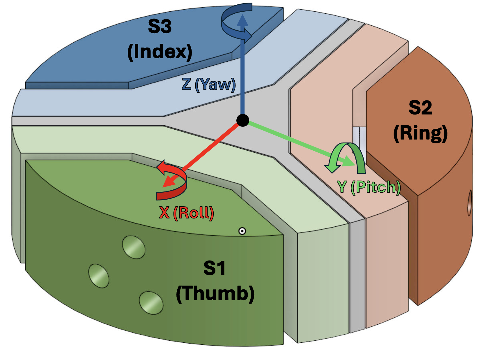

# Finger Manipulation Experiment Protocol

## Repository Layout

All acquisition and experiment functionality lives in `utils/`, grouped by purpose. Recorded and generated data lives in `data/`; analysis notebooks live in `data_process/`.

```text
utils/
├── acquisition/              # NI-DAQ and LabJack device readers
├── publishers/               # ROS 2 force publishing and frame transformations
├── recording/                # CSV recorders
├── calibration/              # Position sensor rotational error nodes
├── visualization/            # RViz object-axis visualization
├── gui/                      # Researcher and participant interface
├── object_meshes/            # Final colored 50mm.glb and 80mm.glb used by the GUI
├── launch/                   # Multi-recorder launcher
├── config/calibration_files/ # ATI .cal files
└── paths.py                  # Shared repository, data, and calibration paths
data/
├── user_*/                   # Participant recordings
├── sensor_bias/              # Sensor bias CSV and JSON files
├── synced_data/              # Synchronized analysis data
├── segmented_data/           # Segmented analysis data
└── analysis_results/         # PCA figures and other analysis outputs
data_process/                # Single-trial and multi-trial analysis notebooks
docs/images/                 # Protocol reference images
docs/mesh_sources/           # Original GLB exports, original STLs, and legacy display assets
```

Existing experiment folders under `data/` retain their layout.

## Running the Experiment

Run the following commands from the repository root using the existing Python environment with ROS 2, the Polhemus workspace, and the NI-DAQ/LabJack drivers configured. The publishers require the corresponding hardware; finger-frame transformations also require the Polhemus TF stream. Source the ROS/workspace setup scripts as usual before starting nodes.

For NI-DAQ on Windows and LabJack on this Linux computer, use centralized
processing. Both acquisition nodes send ATI-calibrated **uncorrected** force and
torque. Linux owns the bias for all three sensors and applies the Polhemus
coordinate transforms. The Windows computer requires no bias commands or bias
file transfers during the experiment.

First start NI-DAQ in the Windows repository root:

```powershell
python -m utils.publishers.NIDAQ_ATI_publisher --ros-args -p raw_only:=true
```

On Linux, start LabJack in a separate terminal and start the existing Polhemus TF
stream as usual:

```bash
python -m utils.publishers.Labjack_ATI_publisher --ros-args -p raw_only:=true
```

Once the acquisition nodes are running, start the processing node on Linux:

```bash
python -m utils.publishers.ATI_processing_node
```

Keep all three ATI sensors unloaded and stationary. The processor waits for fresh
messages from every sensor, then uses one shared 0.5-second warmup and 5-second
source-time measurement window. Calibration commits only when every sensor has
enough samples, no excessive gaps, and the complete result has saved. Corrected
output begins after success. If an acquisition node was not running before the
15-second startup deadline, start it and request calibration again on Linux:

```bash
ros2 service call /ERIE_Manipulation/force/rebias std_srvs/srv/Trigger "{}"
```

This command also re-zeroes all three sensors later without restarting Windows or
either acquisition node. The service acknowledges **acceptance**, not completion.
Wait for the processing terminal's success message, or inspect the JSON status:

```bash
ros2 topic echo /ERIE_Manipulation/force/processing_status
```

Successful calibration reports `state: "ready"`, `busy: false` and increments
`generation`. A new request pauses processed output; use it between recordings.
Failure retains the previous complete bias set and resumes output using it. An
initial failure leaves processed output unavailable until calibration succeeds.

The advisor GUI provides the same operation through the **Force bias** button
below the User Number / Trial row. Keep all three sensors unloaded and stationary,
click it, and wait for **Force bias complete** before starting a trial. The row
shows waiting, warmup, sample collection and errors. It remains responsive while
the ROS request runs. A service acknowledgement only means the request was
accepted; completion is confirmed by the matching processor status. Each request
and processor instance has an identifier so an old status or a restarted processor
cannot be mistaken for completion of the GUI's current request.
If a request confirmation is lost, the GUI keeps trial starts blocked until it
receives an authoritative result. If confirmation does not recover, restart the
central processor and GUI; both acquisition nodes can remain running.

The button is disabled during preparation, recording, angle tests, saving, another
bias operation, and when the processor is unavailable. It can be used during rest.
Trial starts from the advisor or participant's Space key wait until the bias
operation finishes, including when the F/T requirement checkbox is unchecked.
Demo mode displays the button disabled and never sends a hardware request. The
GUI controls an independently running central processor; start it as described
above. It does not start acquisition nodes or the processor automatically.

For a first calibration controlled entirely from the GUI, start the processor
without automatic zeroing, then open the live GUI:

```bash
python -m utils.publishers.ATI_processing_node --ros-args -p bias_on_start:=false
python -m utils.gui.study_gui
```

Run these in separate terminals after starting both `raw_only:=true` acquisition
nodes. Click **Force bias** in the advisor; subsequent zeroing uses the same
button without restarting either acquisition node. Restart both the processor and
GUI after updating to load the matching request/status protocol.

The acquisition topics are
`/ERIE_Manipulation/acquisition/wrench_s1_uncorrected`,
`wrench_s2_uncorrected`, and `wrench_s3_uncorrected` under the same prefix. Each
`Float64MultiArray` contains `[Fx, Fy, Fz, Tx, Ty, Tz, source_timestamp_sec]`, in
N, N-mm and Unix seconds. These are ATI-calibrated values, not voltages. They have
no local bias subtraction or TF transformation in `raw_only` mode. The processor
preserves that source timestamp in all outputs; it never replaces it with Linux
receipt time. Current source timestamps represent acquisition-host read completion,
not hardware clock timestamps or guaranteed simultaneous hardware sampling.

Windows and Linux must still have synchronized system clocks and a shared ROS 2
domain/network. Stale/future timestamps and duplicate/out-of-order samples are
rejected. The processor retries source-time TF lookups using bounded queues;
missing TF suppresses transformed output while bias-corrected raw output continues.
The existing `force_sN_raw`, `force_sN_fingerN`, and `wrench_sN_fingerN` topics
keep their names, units and schemas, so the GUI and recorders work as before.
Open the GUI with `python -m utils.gui.study_gui` to request or monitor calibration.

Central calibration files are saved only on Linux at
`data/sensor_bias/bias_csv/Central_ATI_Bias.csv` and
`data/sensor_bias/bias_json/Central_ATI_Bias.json`. The CSV is headerless with
columns `sensor_id, source_timestamp_sec, Fx, Fy, Fz, Tx, Ty, Tz`; JSON includes
all three offsets, sample counts, common time window and units. Existing saved
calibrations are not automatically loaded. To wait for a manual first request,
start the processing node with `--ros-args -p bias_on_start:=false`.

Central parameters include `bias_time_sec` (5.0), `bias_warmup_sec` (0.5),
`bias_timeout_sec` (15.0), `bias_min_samples` (30 per sensor),
`bias_max_gap_sec` (0.5), `max_sample_age_sec` (0.5) and `max_tf_age_sec` (1.5).
The timeout must exceed warmup + measurement window + maximum sample age. For a
10-second measurement window, use:

```bash
python -m utils.publishers.ATI_processing_node --ros-args -p bias_time_sec:=10.0 -p bias_timeout_sec:=25.0
```

The original direct-processing mode remains available with `raw_only:=false`
(the hardware publishers' default). Start each publisher in its own terminal for
that mode. Run the central processor together with both `raw_only:=true`
acquisition nodes; the direct publishers already own the processed output topics.

```bash
python -m utils.publishers.NIDAQ_ATI_publisher
python -m utils.publishers.Labjack_ATI_publisher
python -m utils.publishers.Object_Origin_ATI_publisher --ros-args -p diameter_mm:=50
```

Set `diameter_mm` to the object being used (`50` or `80`). The object-origin publisher subscribes to the raw force topics from the two hardware publishers.

In direct-processing mode, both hardware publishers automatically zero their ATI sensors at startup. Keep the
sensors unloaded and stationary until calibration finishes. By default, they discard
0.5 seconds of warmup scans and average 5 seconds of valid scans at the device's
actual acquisition rate. NI-DAQ includes every buffered scan; LabJack uses the same
stream acquisition path used during publishing. Zero-valued scans are valid;
nonfinite values and LabJack's skipped-scan markers are excluded. Invalid scans
extend the collection window until enough valid samples arrive or the timeout expires.

The bias is computed before any old bias is subtracted, so repeated zeroing estimates
the complete offset. Completed calibration scans are written once to
`data/sensor_bias/bias_csv/`, with bias values and acquisition metadata in
`data/sensor_bias/bias_json/`. Existing JSON keys (`NIDAQ_S1`, `NIDAQ_S2`, `Labjack`)
are preserved; `_metadata` records the sample count, actual rate, and warmup.
Collection failure or cancellation retains the previous calibration. File writes
are staged, and a handled replacement failure attempts to restore both previous
files. Device initialization failures release the hardware resources.

The same ROS parameters are available on both publishers:

| Parameter | Default | Meaning |
| --- | --- | --- |
| `bias_on_start` | `true` | Compute a fresh bias at startup; `false` leaves a zero offset and does not load a saved bias |
| `bias_time_sec` | `5.0` | Valid-sample window in seconds, converted to a scan count using the actual device rate |
| `bias_warmup_sec` | `0.5` | Initial scans to discard, expressed in seconds |
| `bias_timeout_sec` | `15.0` | Collection deadline; increase this when increasing the window or warmup |

For example, use a 10-second window (run each command in a separate terminal):

```bash
python -m utils.publishers.NIDAQ_ATI_publisher --ros-args -p bias_time_sec:=10.0 -p bias_timeout_sec:=25.0
python -m utils.publishers.Labjack_ATI_publisher --ros-args -p bias_time_sec:=10.0 -p bias_timeout_sec:=25.0
```

Bias deadlines use monotonic time, so system-clock synchronization does not change
the window. A blocking LabJack native read can extend the deadline until LJM's
finite, calculated stream timeout returns. In this direct-processing mode, restart
the hardware publishers to collect a fresh startup bias. The GUI's Force bias
button controls the centralized processing mode described above.

Record a trial with one of the following commands, or use the launcher below to start all three recorders:

```bash
python -m utils.recording.force_trial_csv_recorder -u 1 -s 50 -t roll -tn 1
python -m utils.recording.force_raw_csv_recorder -u 1 -s 50 -t roll -tn 1
python -m utils.recording.object_origin_csv_recorder -u 1 -s 50 -t roll -tn 1

python -m utils.launch.recoder_launch -u 1 -s 50 -t roll -tn 1
```

The launcher opens three GNOME Terminal windows and requires `gnome-terminal`. The existing `recoder_launch` spelling is retained.

| Argument | Meaning |
| --- | --- |
| `-u`, `--user-number` | Participant number |
| `-s`, `--diameter-mm` | Object diameter: `50` or `80` |
| `-t`, `--task-performed` | `roll`, `pitch`, `yaw`, `finger_gating`, or `single_fg` |
| `-tn`, `--trial-number` | Trial number |
| `--duration-sec` | Recording duration; default `30`, or `0` until Ctrl+C |
| `--data-root` | Override the default repository `data/` directory |
| `--flush-every` | Flush CSV files after this many samples; default `25` |
| `--sensor-subfolders` | Put each finger's CSV in a separate sensor folder |
| `--overwrite` | Delete the existing trial folder before recording; otherwise append |

Default data and calibration paths are resolved from the repository location, independent of the working directory. The module commands above still require the repository root on Python's module search path. An explicitly supplied relative `--data-root` is relative to the working directory.

To use the researcher/participant GUI:

```bash
python -m utils.gui.study_gui --demo
python -m utils.gui.study_gui
```

The GUI opens separate researcher and participant windows. Demo mode runs with Tkinter and NumPy on a graphical desktop, generates simulated force/torque and tracking data, and saves it under `data/demo/` by default. Live mode uses the running hardware publishers and Polhemus TF stream. The GUI records its own data; the standalone recorders are not needed for this workflow.

In **demo mode**, the advisor has a **DEMO · DATA SAVING** row directly below the User Number / Trial controls at the top. Its **Save data (CSV + metadata)** checkbox is checked by default. Uncheck it to test the complete workflow without creating session folders, CSV files, or metadata files, including during angle tests. The choice applies to the next trial or angle test and is locked during preparation, recording, and saving; it can be changed during rest. The interface explicitly labels trials with recording disabled as **DEMO PREVIEW**. Live mode always records data. Restart the GUI after updating the code, using `python -m utils.gui.study_gui --demo`, to load the current interface.

Demo participants can use **Space** to move through stages quickly: during the five-second preparation countdown it starts the trial immediately; during cycle counting it finishes the trial as `demo_skipped`; during rest it skips the remaining rest and opens the next preparation countdown. Each press advances one stage, so holding Space does not skip multiple stages. Saving still finishes before progression. Recorded demo trials retain the actual completed cycle count and store `demo_cycle_count_skipped: true` for skipped counting; skips never fabricate 20 completed rotations. Angle tests require the researcher's **Finish angle test** button in both modes; Space during the test does not accept or bypass it. In live/formal mode, Space can skip rest only; preparation still lasts five seconds and trials still require all 20 cycles.

Press **Ctrl+C in the GUI's terminal** or close the advisor window to end the session. The GUI stops recording, processes the remaining recorded orientations, writes all queued CSV rows and final trial metadata, and waits for its recording/acquisition workers and ROS resources to close before destroying the windows. Repeated Ctrl+C presses during saving do not interrupt this cleanup. SIGTERM follows the same save path. An unfinished trial receives `result: "interrupted"` for Ctrl+C, `"terminated"` for SIGTERM, or `"closed"` for window closure; already completed trials keep `"completed"`. Interrupting the countdown creates no trial recording. The terminal reports the saved directory or any save error.

Publishers and recorders started in separate terminals remain independent processes; stop them in their own terminals when finished. The GUI does not own or stop them.

The trial selector follows [Trials_lookup.csv](docs/user_study_docs/Trials_lookup.csv): 40 measured trials and 8 practice trials, covering 50 mm and 80 mm objects. Measured references retain the lookup's `00`–`39` numbering; practice references are `P00`–`P07`. Each task/diameter group has five measured repetitions, displayed as `Task 1/5` through `Task 5/5`.

For each user's Roll, Pitch, and Yaw task at each object diameter, the sequence is **practice → existing rest → angle test → five measured trials**. Practice defaults to ±20° for the 50 mm object and ±10° for the 80 mm object; the researcher can adjust these practice targets. Starting the first measured rotation trial without a valid range measurement opens an angle test after the preparation countdown. The participant starts at neutral and rotates to their maximum in both task directions. The researcher clicks **Finish angle test** after observing both directions. The symmetric measured-trial target is `min(positive maximum, magnitude of negative maximum)`; for example, +42° and −35° produce targets of ±35°. The test uses the same signed integration about the moving object task axis as cycle counting.

Once the angle test finishes and its data has saved, the participant returns to neutral and presses **Space** or the researcher selects **Start trial** to begin the first measured trial's preparation countdown. The accepted target is reused across all five measured repetitions for that same user, diameter, and task during the current GUI run. Selecting a later measured repetition directly still requires a successful angle test for its group. Changing the user, object diameter, or rotation task requires the corresponding group's measurement. A fresh GUI run requires new measurements. Finger gaiting (`G`) keeps its manual-count workflow and requires no rotation angle test.

A tracking gap or invalid/discontinuous orientation history invalidates the angle test; repeat it from neutral. Finishing before both directions have been measured, cancelling the test, or failing to save it also leaves measured trials unavailable until a successful test completes. The test is stored separately from trial recordings, and its successful result is copied into each measured trial's metadata. Demo preview runs keep the same workflow without creating calibration files or trial files.

The participant window has a white background and displays trial/task information, overall progress, the object mesh, and the target axis. It omits the STL caption, individual rotation-phase instructions, and the five-step sequence strip. The selected 50 mm or 80 mm mesh follows sensor 4 orientation relative to a captured baseline, converted using the configured sensor-to-object mounting relationship. Roll, pitch, and yaw always use the object's moving X, Y, and Z axes respectively. The target axis follows the object as the participant adjusts their wrist.

With the participant window focused, press **Space** to start the selected trial or its required angle test. After completing 20 cycles and saving the data, the participant automatically enters a rest period. In either mode, press **Space** during rest to skip its remainder and enter the next preparation countdown. When rest finishes naturally, press **Space** when ready to proceed. The participant display shows a **five-second circular countdown** before each start; it captures a fresh orientation baseline when the countdown ends. The advisor's Start button uses the same countdown and can cancel it. In live mode, Space is ignored during preparation, recording, and saving; holding Space does not submit repeated requests. Early stops and save errors require the researcher to select or restart a trial. After the last trial, the participant sees a completion message.

Rest durations come from [Rest_Time.py](docs/user_study_docs/Rest_Time.py), whose values are in **minutes**. The current settings are 60 seconds between trials, 120 seconds between tasks, and 300 seconds between objects. Only one duration applies at a boundary: changing objects takes priority over changing tasks, then ordinary trial rest. Practice-to-measured transitions within the same task/object use the ordinary trial rest. Both preparation and rest use the same circular display, with only the integer remaining seconds in its center. No elapsed / total time appears below the ring. Rest finishes on `0` with a Space prompt. The first trial and the end of the study have no rest period. Advisor trial-start/navigation controls wait until rest finishes or the participant skips it with Space; Ctrl+C still saves and closes normally.

Edit the minute values and restart the GUI to change rest durations, or use `--rest-config PATH` with an alternative configuration containing `trials`, `tasks`, and `objects`. A zero value omits that rest; fractional seconds round up to whole seconds. Each session's metadata records the loaded rest configuration and durations.

Counting requires a complete rotation cycle: **neutral → negative target → neutral → positive target → neutral**. These zones use the signed sum of consecutive rotations about the moving task axis. Neutral means that this cycle angle is within the neutral band. Measured rotation trials use the group's accepted angle-test target; the researcher can adjust the default neutral band of ±5° and 0.12-second hold requirement. The trial stops automatically at 20 cycles; stopping early also saves the recorded data. Tracking interruptions discard an unfinished cycle while retaining completed cycles; the first valid recovered pose establishes a new zero and starts a fresh neutral hold. The `G` / finger-gating task currently uses the researcher's manual `+1` count pending a defined automatic counting rule.

For example, `80R0` means the 80 mm object, Roll, repetition 0; it is displayed as `Task 1/5`. Both windows start in normal windowed mode. F11 toggles fullscreen in the focused window; Escape exits fullscreen. Move the participant window to its own monitor if needed. Both windows scale their fonts independently with their window size. The digital twin uses the same additional **1.30× uniform display scale** for the 50 mm and 80 mm models, including their reference axes. This display enlargement preserves model proportions and the original rotation origin. Restoring the window size restores its font sizes.

The advisor's three charts show Thumb, Index, and Middle, each with six signed bars and separate force/torque scales. By default, starting a trial requires fresh sensor-4 tracking and all three six-component F/T streams. Interrupted or missing F/T data and recorder queue overflows are flagged for review; stale bars are not presented as current measurements.

`utils/object_meshes/` contains only the two final colored models used by the GUI: `50mm.glb` and `80mm.glb`. They retain the six material colors and eleven parts from the original Onshape exports in `docs/mesh_sources/`. Geometry preparation simplifies each part/material region independently and checks topology, material assignments, scene origin, and physical bounds before installing the result. To regenerate either final model:

```bash
python -m utils.gui.glb_prepare docs/mesh_sources/50mm.glb utils/object_meshes/50mm.glb --overwrite
python -m utils.gui.glb_prepare docs/mesh_sources/80mm.glb utils/object_meshes/80mm.glb --overwrite
```

The preparation command saves one final GLB and preserves its source. Preparing dense models requires VTK, available in the system Python environment on this workstation. VTK is only needed for preparation; the GUI uses Tkinter, NumPy, and Python's standard library at runtime. The current loader supports uncompressed GLB geometry with flat material colors. The previous display STLs are archived under `docs/mesh_sources/legacy_display/`; standalone STL loading and the `utils.gui.mesh_repair` preparation command remain available for legacy models.

Reference axes start at the model's original scene `(0, 0, 0)`, and orientation rotates around this same origin. Camera framing uses a separate display offset; it does not replace the model origin with its bounding-box center. GLB metre coordinates are converted to millimetres while preserving the exported XYZ orientation. Reference arrows are thicker, with additional emphasis on the task's target axis. Trial metadata records the actual model path and its origin.

GUI configuration options:

| Argument | Meaning |
| --- | --- |
| `--demo` | Generate simulated samples; default save root is `data/demo/` |
| `--data-root` | Override the save root; live mode defaults to repository `data/` |
| `--protocol` | Override the trial lookup CSV |
| `--rest-config` | Rest_Time.py-style configuration; values are minutes |
| `--mesh-dir` | Directory containing prepared 50 mm and 80 mm GLB models; legacy STL is supported |
| `--timezone` | Time zone used for session and trial folder timestamps |

Practice targets and the sensor-4 mounting rotation are configured in [Rest_Time.py](docs/user_study_docs/Rest_Time.py), alongside the rest durations. Edit `PRACTICE_TARGETS_DEG = {50: 20, 80: 10}` to set the practice targets in degrees by object diameter in millimetres. Edit the 3×3 `SENSOR4_FROM_OBJECT` list to set `sensor4 T_object` for both object sizes and both live/demo modes. The file accepts literal values; the matrix uses `0.8660254037844386` for `sqrt(3)/2`. Restart the GUI after editing. The `--rest-config` option selects an alternative file with all five settings. Session metadata records the loaded targets and matrix; each trial records its actual target and matrix. For three-component vectors, `v_sensor4 = T @ v_object`, with the default:

```text
T = [[-0.5,      sqrt(3)/2,  0],
     [sqrt(3)/2, 0.5,        0],
     [ 0,        0,         -1]]
```

The displayed mesh uses `C = T.T @ R0.T @ Rt @ T`, where `R0` is the baseline sensor-4 rotation and `Rt` is its current rotation. Cycle counting uses consecutive poses: `D = C_previous.T @ C_current = T.T @ R_previous.T @ R_current @ T`. Each step's signed twist is measured about the previous object frame's task axis and added to the cycle angle in `rotation_progress.csv`. Thus yaw follows object Z even after object Z has tilted away from its initial direction. Start normally with `python -m utils.gui.study_gui`; no alignment argument is required. Trial metadata stores `object_to_sensor4_matrix`, `rotation_frame: "moving_object"`, `mesh_rotation_frame: "baseline_object"`, and the cycle-angle definition/reset policy. The existing `mesh_to_sensor4_matrix` field holds the same mounting rotation. `object_orientation.csv` retains the original sensor-4 quaternions.

Both windows also show **Axis error** and **Accumulated angle** during a rotation trial. These use the moving object axes: `D = T.T @ R_previous.T @ R_current @ T` expresses each incremental rotation in the previous sample's object frame. Axis error is `degrees(acos(abs(dot(increment_axis, task_axis))))`, from 0° to 90°; forward and reverse movement along the same axis have equal error. Accumulated angle sums the signed task-axis twist of each valid increment. It follows the motion path and can accumulate measurement noise; returning this sum to zero does not necessarily restore the starting orientation. Sensor 4 measures the total object motion, including motion caused by wrist adjustments.

Axis error is unavailable when the inter-sample rotation is below 0.05°, matching the existing RViz minimum-motion setting. This is a motion threshold, not a calibrated noise bound. Small valid angle increments still contribute to the cycle and accumulated angles. Duplicate timestamps are ignored. A gap above 0.5 seconds, backwards/invalid samples, tracking loss, or a pose-queue overflow breaks the adjacent-sample reference. The cycle angle is re-zeroed at the first valid recovered pose, while the trial's accumulated angle retains the sum of observed intervals and is marked **partial**. Trial metadata records the method, thresholds, accumulated angle, and continuity. Axis error is feedback; cycle progression uses the local task-angle sequence and its hold times. Finger gaiting has no defined target rotation axis and displays N/A.

GUI recordings use a session/task/trial structure:

```text
data/
└── User001_MDY_HM/
    ├── session_metadata.json
    ├── RotationCalibration/
    │   └── User001_80mm_roll_MDY_HM/
    │       ├── object_orientation.csv
    │       ├── rotation_progress.csv
    │       ├── rotation_axis_error.csv
    │       ├── thumb.csv
    │       ├── index.csv
    │       ├── middle.csv
    │       ├── thumb_raw_force.csv
    │       ├── index_raw_force.csv
    │       ├── middle_raw_force.csv
    │       └── trial_metadata.json
    └── Roll/
        └── User001_Trial20_MDY_HM/
            ├── thumb.csv
            ├── index.csv
            ├── middle.csv
            ├── thumb_raw_force.csv
            ├── index_raw_force.csv
            ├── middle_raw_force.csv
            ├── object_orientation.csv
            ├── rotation_progress.csv
            ├── rotation_axis_error.csv
            └── trial_metadata.json
```

`MDY_HM` means `%m%d%Y_%H%M`, for example `10232026_1430`. Session and trial timestamps describe their respective start times. Task folders are `Roll`, `Pitch`, `Yaw`, and `FingerGaiting`. Repeated session/trial names within the same minute receive a suffix such as `_02` to preserve existing recordings. Practice trials retain their `Pxx` reference in the trial folder name.

Angle-test folders are reserved independently under `RotationCalibration`; repeated attempts also receive unique suffixes. They contain the same sensor and progress CSV streams as trial recordings. Their `trial_metadata.json` has `recording_kind: "rotation_calibration"`, `target_cycles: null`, `target_deg: null`, and the observed range and continuity. Normal test results are `calibration_completed`, `calibration_failed`, and `calibration_cancelled`; shutdowns retain their interruption reason. A successful `rotation_calibration` record stores the positive and negative maxima, selected symmetric target, selection rule, user/diameter/task, object-frame method, timestamps, and recording path. Each measured trial copies that record into its own `rotation_calibration` field alongside its actual target angle. Calibration samples therefore remain separate from the 20-cycle trial data.

Each finger CSV contains `source_timestamp_sec, Fx, Fy, Fz, Tx, Ty, Tz`, with force in N and torque in N·mm. The matching raw files receive calibrated, bias-corrected sensor-frame samples when those topics are available. `object_orientation.csv` stores sensor-4 timestamps and `qx, qy, qz, qw`; `rotation_progress.csv` stores timestamps, elapsed time, signed angle, completed cycles, and counter phase. Session/trial JSON files store the experiment settings and recording details.

`rotation_axis_error.csv` stores `source_timestamp_sec, elapsed_sec, step_rotation_deg, step_angle_deg, accumulated_angle_deg, axis_x, axis_y, axis_z, axis_error_deg, continuous, status`. The axis components are expressed in the previous sample's object frame. Unavailable values are blank; `continuous` indicates whether the accumulated angle has an uninterrupted history for the trial. The file contains only its header for finger-gaiting trials.

For six-component finger-frame data, the hardware publishers provide `/ERIE_Manipulation/force/wrench_s1_finger1` (thumb), `wrench_s3_finger3` (index), and `wrench_s2_finger2` (middle), all under the same `/ERIE_Manipulation/force/` prefix. The existing `force_sN_fingerN` force-only topics remain available. Both force and torque are rotated into the finger-frame axes, but torque retains the ATI measurement origin: no `r × F` moment-transfer term is applied. These torque values therefore do not represent moments transferred to the finger sensor or object origin.

Calibration and visualization nodes are available as modules:

```bash
python -m utils.calibration.rotational_error_node
python -m utils.calibration.relative_rotational_error_node
python -m utils.visualization.object_axis_rviz_visualizer
```

## Sensors and Data

| Sensor | Interface | ATI calibration | Finger |
| --- | --- | --- | --- |
| 1 | NI-DAQ | FT44298 | Thumb |
| 2 | NI-DAQ | FT45281 | Middle |
| 3 | LabJack | FT44297 | Index |

Use the same finger-to-sensor mapping for position sensor calibration.

Standalone recorder trial recordings are stored in:

```text
data/user_{number}/{diameter}mm/{task}/trial_{number}/
```

| Recorder | CSV filenames | CSV columns |
| --- | --- | --- |
| [Finger-frame force](utils/recording/force_trial_csv_recorder.py) | `thumb.csv`, `middle.csv`, `index.csv` | `source_timestamp_sec, Fx, Fy, Fz` |
| [Raw sensor force/torque](utils/recording/force_raw_csv_recorder.py) | `thumb_raw_force.csv`, `middle_raw_force.csv`, `index_raw_force.csv` | `source_timestamp_sec, Fx, Fy, Fz, Tx, Ty, Tz` |
| [Object-origin pipeline](utils/recording/object_origin_csv_recorder.py) | `object_origin_thumb_force.csv`, `object_origin_middle_force.csv`, `object_origin_index_force.csv` | `source_timestamp_sec, Fx, Fy, Fz` |

Here, raw sensor values have already been calibrated and bias-corrected. The object-origin pipeline currently publishes contact-frame force after the object-origin rotation and contact-position calculation; its existing topic and file names are preserved. The GUI's separate session layout and seven-column force/torque format are described above.

Legacy datasets may use `data/{rotation axis}/test_{number}/` with `raw_data.csv` and `transformed_data.csv`. Those older combined files contain three consecutive sensor blocks `[Fx, Fy, Fz, Tx, Ty, Tz]`; the transformed torque columns are zero placeholders. The current recorders use the per-finger formats shown above.

## Data Analysis

Start Jupyter from the repository root or `data_process/`, and open the appropriate notebook:

- [Single-trial Polhemus force analysis](data_process/single_case_polhemus_force_data_analysis.ipynb)
- [Multi-trial Polhemus force analysis](data_process/serial_polhemus_force_data_analysis.ipynb)
- [Single-trial object-origin pipeline analysis](data_process/single_case_object_origin_force_data_analysis.ipynb)
- [Multi-trial object-origin pipeline analysis](data_process/serial_object_origin_force_data_analysis.ipynb)
- [Exploratory notebook](data_process/test.ipynb)

Run the path setup cell first, then set the participant, diameter, task, and trial variables in the notebook. Paths resolve to the repository's `data/` directory. Synchronized and segmented files remain under `data/`, and exported PCA figures are saved to `data/analysis_results/`.

The notebooks currently build paths for the standalone recorders' `data/user_{number}/{diameter}mm/{task}/trial_{number}/` layout. To analyze a new GUI recording, update the notebook's input paths to the selected session/task/trial folder.

In the single-trial PCA routines, combined force and torque data is normalized with `StandardScaler` before PCA. Force-only analysis leaves scaling disabled to preserve the physical magnitude relationships.

## Finger Force to Finger Position Frame Calculations
Fingers 1 & 2 refer to [NIDAQ_ATI_publisher.py](utils/publishers/NIDAQ_ATI_publisher.py). </br>
Finger 3 refers to [Labjack_ATI_publisher.py](utils/publishers/Labjack_ATI_publisher.py).
<b><i><p style= "font-size: 16px;" > Finger Force 1 to Finger  Postion 1 Rotations: </b> </br>
</i> <p style= "font-size: 13px;" > 
<b>F<sub>finger<sub>1</sub></sub></b>
=(
R<sup>T</sup><sub>base←finger<sub>1</sub></sub>
R<sub>base←obj</sub>
R<sub>force<sub>2</sub>'←force<sub>1</sub>'</sub>(120°)
R<sub>object←force<sub>1</sub>'</sub>
R<sub>force<sub>1</sub>'←force<sub>1</sub></sub>(48°)
)
F<sub>force<sub>1</sub></sub>
<b><i><p style= "font-size: 16px;" > Finger Force 2 to Finger Position 2 Rotations:</b> </br>
</i><p style= "font-size: 13px;" > 
<i><b>F<sub>finger<sub>2</sub></sub></b>
=(
R<sup>T</sup><sub>base←finger<sub>2</sub></sub>
R<sub>base←obj</sub>
R<sub>force<sub>2</sub>'←force<sub>2</sub>'</sub>(0°)
R<sub>object←force<sub>2</sub>'</sub>
R<sub>force<sub>2</sub>'←force<sub>2</sub></sub>(48°)
)
F<sub>force<sub>2</sub></sub> </i>
<b> <i> <p style= "font-size: 16px;" > Finger Force 3 to Finger Position 3 Rotations: </b>
</i> <p style= "font-size: 13px;" > 
    <li> Case 1: Includes R<sub>x</sub>(180°) to account for large polhemus sensor </br> </li>

</i> <p style= "font-size: 13px;" > 
<i><b>F<sub>finger<sub>3</sub></sub></b>
=(
R<sub>x</sub>(180°)
R<sup>T</sup><sub>base←finger<sub>3</sub></sub>
R<sub>base←obj</sub>
R<sub>force<sub>2</sub>'←force<sub>3</sub>'</sub>(-120°)
R<sub>object←force<sub>3</sub>'</sub>
R<sub>force<sub>3</sub>'←force<sub>3</sub></sub>(48°)
)
F<sub>force<sub>3</sub></sub> </i>

<li> Case 2:Without R<sub>x</sub>(180°) </br>

</i> <p style= "font-size: 13px;" > 
<i><b>F<sub>finger<sub>3</sub></sub></b>
=(
R<sup>T</sup><sub>base←finger<sub>3</sub></sub>
R<sub>base←obj</sub>
R<sub>force<sub>2</sub>'←force<sub>3</sub>'</sub>(-120°)
R<sub>object←force<sub>3</sub>'</sub>
R<sub>force<sub>3</sub>'←force<sub>3</sub></sub>(48°)
)
F<sub>force<sub>3</sub></sub> </i>

## Finger Force to Object Origin Frame Calculations
Refer to [Object_Origin_ATI_publisher.py](utils/publishers/Object_Origin_ATI_publisher.py).
<b><i><p style="font-size: 16px;">Finger Force 1 & Torque 1 to Object Origin Frame Rotation:</b></i>
<p style="font-size: 13px;">
<b>F<sub>obj_origin₁</sub></b> = R<sub>obj_origin←force</sub>(42°) F<sub>force₁</sub>&nbsp;&nbsp;&nbsp; </br>
<b>τ<sub>obj_origin₁</sub></b> = R<sub>obj_origin←torque</sub>(42°) τ<sub>torque₁</sub>

<b><i><p style="font-size: 16px;">Finger Force 2 & Torque 2 to Object Origin Frame Rotation:</b></i>
<p style="font-size: 13px;">
<b>F<sub>obj_origin₂</sub></b> = R<sub>obj_origin←force</sub>(42°) F<sub>force₂</sub>&nbsp;&nbsp;&nbsp; </br>
<b>τ<sub>obj_origin₂</sub></b> = R<sub>obj_origin←torque</sub>(42°) τ<sub>torque₂</sub>

<b><i><p style="font-size: 16px;">Finger Force 3 & Torque 3 to Object Origin Frame Rotation:</b></i>
<p style="font-size: 13px;">
<b>F<sub>obj_origin₃</sub></b> = R<sub>obj_origin←force</sub>(42°) F<sub>force₃</sub>&nbsp;&nbsp;&nbsp; </br>
<b>τ<sub>obj_origin₃</sub></b> = R<sub>obj_origin←torque</sub>(42°) τ<sub>torque₃</sub>


<b><i><p style="font-size: 16px;">Contact Point Solution (θ, h):</b></i>
<p style="font-size: 13px;">
Given <b>F<sub>object<sub>i</sub></sub></b> = (f<sub>x</sub>′, f<sub>y</sub>′, f<sub>z</sub>′) and <b>τ<sub>object<sub>i</sub></sub></b> = (τ<sub>x</sub>′, τ<sub>y</sub>′, τ<sub>z</sub>′): </br>
φ = atan2(f<sub>x</sub>′, f<sub>z</sub>′) </br>
θ<sub>i</sub> = arcsin( −(l·f<sub>x</sub>′ + τ<sub>y</sub>′) / (R·√(f<sub>x</sub>′²+f<sub>z</sub>′²)) ) + φ </br>
h<sub>i</sub> = H + (τ<sub>z</sub>′ − f<sub>y</sub>′·R·sin θ<sub>i</sub>) / f<sub>x</sub>′
<p style="font-size: 12px;">
where l is the fixed lever offset from sensor origin to object origin, <i>R</i> is the object (cylinder) radius, and <i>H</i> is the sensor origin height offset.


<b><i><p style="font-size: 16px;">Finger Force to Contact Frame Rotation:</b></i>
<p style="font-size: 13px;">
<b>F<sub>contact<sub>i</sub></sub></b> = R<sub>contact←object</sub>(θ<sub>i</sub>) F<sub>object<sub>i</sub></sub>
<p style="font-size: 12px;">
R<sub>contact←object</sub>(θ) =
[ 0&nbsp;&nbsp;&nbsp;1&nbsp;&nbsp;&nbsp;0 ;
−cos θ&nbsp;&nbsp;&nbsp;0&nbsp;&nbsp;&nbsp;sin θ ;
sin θ&nbsp;&nbsp;&nbsp;0&nbsp;&nbsp;&nbsp;cos θ ]

## Error Calculations
For finger to object refer to [relative_rotational_error_node.py](utils/calibration/relative_rotational_error_node.py).</br>
For finger to base refer to [rotational_error_node.py](utils/calibration/rotational_error_node.py).

<b><i> <p style= "font-size: 16px;" > Calibrating Finger Postion Sensor to Object Postion Sensor Rotations: </b></br>
</i> <p style= "font-size: 12px;" > 
<i><b>R<sub>finger←object</sub></b>
=R<sup>T</sup><sub>base←finger</sub>
R<sub>base←object</sub>
<p style= "font-size: 12px;" > 
<b>Error</b>
=tr(
R<sub>finger←object</sub>
)
− 3 </i>
<b><i><p style= "font-size: 16px;" > Calibrating Finger Position Sensor to Polhemus Base Rotations: </b> </br>
</i> <p style= "font-size: 12px;" > 
<i><b>R<sub>error</sub></b>
=R<sup>T</sup><sub>GT</sub>
R<sub>base←sensor</sub> 
<p style= "font-size: 12px;" > 
<b>Error</b>
=tr(
R<sub>error</sub>
)
− 3

## Reference 

